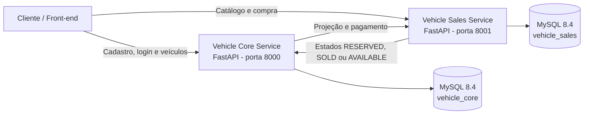
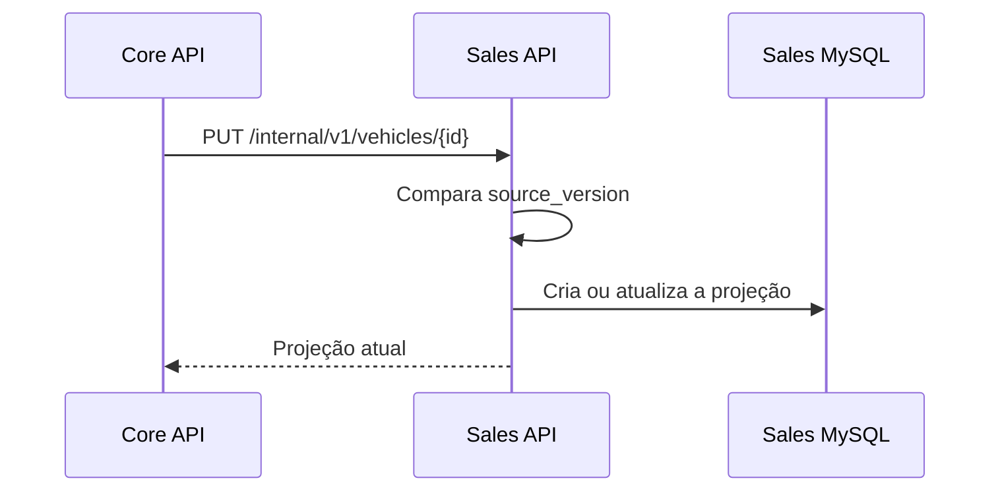
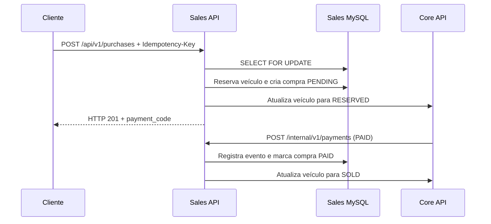
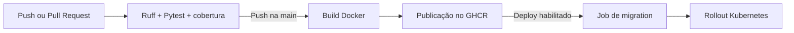

# Vehicle Sales Service

[](https://github.com/Hackaton-Fiap-Matheus-Pereira/vehicle-sales-service/actions/workflows/ci-cd.yml)

Microsserviço de vendas da plataforma de revenda de veículos desenvolvida para o **Tech Challenge SOAT - Fase 4**.

O Sales mantém uma projeção própria do catálogo, lista veículos disponíveis e vendidos, reserva veículos, registra compras com CPF e processa decisões de pagamento. O cadastro canônico, a autenticação e o webhook externo pertencem ao [Vehicle Core Service](https://github.com/Hackaton-Fiap-Matheus-Pereira/vehicle-core-service).

## 🎯 Objetivo da solução

Isolar o domínio comercial da plataforma, oferecendo consultas e compras sem acesso direto ao banco do Core.

O fluxo principal contempla:

1. recebimento da projeção versionada de um veículo;
2. listagem dos disponíveis por preço crescente;
3. reserva transacional do veículo;
4. validação e armazenamento do CPF do comprador;
5. geração de código de pagamento;
6. processamento idempotente do pagamento;
7. listagem dos vendidos por preço crescente;
8. sincronização do estado comercial com o Core.

## ✅ Requisitos atendidos

| Requisito | Implementação |
|---|---|
| Listar disponíveis por preço | `GET /api/v1/vehicles/available` |
| Listar vendidos por preço | `GET /api/v1/vehicles/sold` |
| Comprar veículo | `POST /api/v1/purchases` |
| Consultar compra | `GET /api/v1/purchases/{payment_code}` |
| Validar comprador | CPF normalizado e validado pelos dígitos verificadores |
| Evitar venda duplicada | Transação com `SELECT ... FOR UPDATE` |
| Evitar compra duplicada | Header `Idempotency-Key` |
| Processar pagamento uma única vez | `event_id` único e processamento idempotente |
| Separar os dados por domínio | Banco MySQL exclusivo do Sales |
| Automatizar qualidade e entrega | Ruff, Pytest, GitHub Actions, GHCR e deploy Kubernetes opcional |

## 🏗️ Arquitetura da solução



| Componente | Porta local | Responsabilidade |
|---|---:|---|
| Vehicle Core Service | `8000` | Identidade, JWT, cadastro canônico e webhook |
| Vehicle Sales Service | `8001` | Catálogo, reserva, compra e vendidos |
| Core MySQL | Interna | Usuários e veículos canônicos |
| Sales MySQL | Interna | Projeções, compras e eventos de pagamento |

### Separação dos dados

O Sales nunca acessa o banco do Core. Ele recebe uma projeção mínima do veículo por HTTP e mantém suas próprias tabelas. As chamadas internas usam `X-Service-Token`.

## 🔁 Fluxos principais

### Sincronização do catálogo



Versões antigas são ignoradas de forma determinística, evitando que mensagens atrasadas sobrescrevam dados mais recentes.

### Compra e pagamento



Em cancelamentos, a compra passa para `CANCELED` e o veículo volta a `AVAILABLE`.

## 🗄️ Persistência de dados

O Sales utiliza **MySQL 8.4**, SQLAlchemy 2 assíncrono e Alembic.

### `vehicle_listings`

- identificador igual ao veículo canônico;
- marca, modelo, ano, cor e preço;
- `source_version` recebido do Core;
- status `AVAILABLE`, `RESERVED` ou `SOLD`;
- datas de criação e atualização.

### `purchases`

- veículo comprado;
- CPF normalizado;
- preço congelado no momento da compra;
- data da compra;
- código de pagamento único;
- chave de idempotência opcional e única;
- status `PENDING`, `PAID` ou `CANCELED`;
- estado e tentativas de sincronização com o Core.

### `payment_events`

- `event_id` único;
- compra e código de pagamento;
- decisão `PAID` ou `CANCELED`;
- data de ocorrência e processamento.

## 🔐 Segurança e regras de negócio

- endpoints internos protegidos por `X-Service-Token`;
- comparação segura do token de serviço;
- CPF validado pelos dígitos verificadores;
- CPF mascarado nas respostas públicas;
- bloqueio transacional com `SELECT ... FOR UPDATE`;
- idempotência da compra com `Idempotency-Key`;
- idempotência do pagamento com `event_id`;
- paginação com `limit` e `offset`;
- ordenação crescente por preço;
- schemas Pydantic para validação;
- `.env` excluído do versionamento;
- container executado como usuário não-root.

## 🚀 Tecnologias utilizadas

- Python 3.12;
- FastAPI;
- SQLAlchemy 2 assíncrono;
- MySQL 8.4;
- Alembic;
- Pydantic v2;
- HTTPX;
- Docker;
- Kubernetes;
- Pytest e Ruff;
- GitHub Actions;
- GitHub Container Registry.

JWT e Argon2 pertencem ao Core, responsável por identidade e autenticação.

## 📋 Pré-requisitos

Para executar a plataforma completa:

- Docker Desktop;
- Docker Compose v2;
- Git.

O arquivo de composição e a infraestrutura compartilhada ficam no repositório Core.

## 🛠️ Execução local da plataforma

### 1. Clonar os dois repositórios como diretórios irmãos

```bash
git clone https://github.com/Hackaton-Fiap-Matheus-Pereira/vehicle-core-service.git
git clone https://github.com/Hackaton-Fiap-Matheus-Pereira/vehicle-sales-service.git
cd vehicle-core-service
```

### 2. Configurar o ambiente

Linux ou macOS:

```bash
cp compose.env.example .env
```

Windows PowerShell:

```powershell
Copy-Item compose.env.example .env
```

Substitua todos os valores `CHANGE_ME` do `.env`.

### 3. Subir a plataforma

```bash
docker compose up --build --wait
```

O Sales ficará disponível em `http://localhost:8001`.

### Execução isolada para desenvolvimento

Com Python 3.12 e um MySQL acessível:

```bash
python -m venv .venv
python -m pip install --upgrade pip "-e" ".[dev]"
cp .env.example .env
alembic upgrade head
uvicorn app.main:app --reload --port 8001
```

No PowerShell, ative o ambiente com `.\.venv\Scripts\Activate.ps1` e copie o arquivo com `Copy-Item .env.example .env`.

## 🌐 URLs da aplicação

| Recurso | URL |
|---|---|
| Swagger | http://localhost:8001/docs |
| OpenAPI | http://localhost:8001/openapi.json |
| Liveness | http://localhost:8001/health/live |
| Readiness | http://localhost:8001/health/ready |

## 📚 Endpoints

### API pública

| Método | Endpoint | Descrição |
|---|---|---|
| `GET` | `/api/v1/vehicles/available` | Lista disponíveis pelo menor preço |
| `GET` | `/api/v1/vehicles/sold` | Lista vendidos pelo menor preço da venda |
| `POST` | `/api/v1/purchases` | Reserva o veículo e cria o código de pagamento |
| `GET` | `/api/v1/purchases/{payment_code}` | Consulta uma compra com CPF mascarado |
| `GET` | `/health/live` | Verifica o processo |
| `GET` | `/health/ready` | Verifica a conexão com o banco |

### API interna

| Método | Endpoint | Proteção | Descrição |
|---|---|---|---|
| `PUT` | `/internal/v1/vehicles/{vehicle_id}` | `X-Service-Token` | Cria ou atualiza a projeção |
| `POST` | `/internal/v1/payments` | `X-Service-Token` | Confirma ou cancela um pagamento |
| `POST` | `/internal/v1/purchases/{purchase_id}/sync` | `X-Service-Token` | Repete a sincronização com o Core |

## 🧪 Demonstração ponta a ponta

O script de demonstração está no repositório Core. Com a plataforma saudável, execute nele:

```powershell
.\scripts\e2e-demo.ps1
```

Durante o fluxo, o Sales:

1. recebe o veículo cadastrado no Core;
2. confirma sua presença nos disponíveis;
3. cria uma compra idempotente;
4. reserva o veículo com bloqueio transacional;
5. processa o pagamento recebido pelo Core;
6. move o veículo para a lista de vendidos.

Resultado esperado:

```text
Fluxo ponta a ponta concluído com sucesso.
```

## 🧪 Testes automatizados

```bash
python -m venv .venv
python -m pip install --upgrade pip "-e" ".[dev]"
ruff check .
ruff format --check .
pytest
```

Os testes usam SQLite assíncrono em memória e um cliente falso para o Core. Não é necessário iniciar MySQL ou Docker. A cobertura mínima exigida é 80%.

## 🐳 Docker

```bash
docker build -t vehicle-sales-service:local .
docker run --rm --env-file .env -p 8001:8000 vehicle-sales-service:local
```

A imagem utiliza Python 3.12, instala suporte ao método `caching_sha2_password` do MySQL 8.4 e executa como usuário não-root.

## 🔄 Pipeline CI/CD

O workflow `.github/workflows/ci-cd.yml` é executado em Pull Requests e pushes na `main`.



### Pull Request

- configura Python 3.12;
- instala as dependências;
- executa Ruff;
- executa Pytest com cobertura mínima de 80%.

### Push ou merge na `main`

- constrói a imagem Docker;
- publica as tags `latest` e SHA do commit no GHCR;
- utiliza o `GITHUB_TOKEN` fornecido automaticamente pelo GitHub.

Imagem publicada:

```text
ghcr.io/hackaton-fiap-matheus-pereira/vehicle-sales-service
```

### Deploy Kubernetes opcional

O deploy é executado quando o repositório possui:

- variável `ENABLE_K8S_DEPLOY=true`;
- secret `KUBE_CONFIG_B64`;
- variável opcional `KUBE_NAMESPACE`, com padrão `vehicle-sales`.

Sem essas configurações, qualidade, testes, build e publicação no GHCR continuam funcionando; somente o job de deploy fica ignorado.

## ☸️ Kubernetes e Terraform

Os manifests compartilhados, a configuração do Kind e o Terraform ficam no repositório Core, que centraliza a infraestrutura da plataforma. O Sales possui Deployment, Service, Job Alembic, banco MySQL isolado, volume persistente, NetworkPolicy e HPA próprios.

## 📊 Logs e diagnóstico

Na pasta do repositório Core:

```bash
docker compose logs -f vehicle-sales-service
docker compose logs sales-migrations
docker compose ps -a
```

No Kubernetes:

```bash
kubectl get pods,deploy,sts,svc,pvc,hpa -A
kubectl logs deployment/vehicle-sales-service -n vehicle-sales
```

## ⚠️ Limitações do MVP

- não existe interface front-end;
- o ambiente local utiliza HTTP sem TLS;
- a integração entre os serviços é síncrona por HTTP;
- o CPF é armazenado no banco transacional, embora seja mascarado na API;
- não há observabilidade avançada com métricas e traces;
- o deploy permanente exige um cluster acessível ao GitHub Actions.

## 🔮 Possíveis evoluções

- mensageria para sincronização assíncrona;
- padrão outbox para eventos de integração;
- criptografia adicional de dados sensíveis em repouso;
- retentativas automáticas com backoff;
- rate limiting;
- OpenTelemetry, Prometheus e Grafana;
- testes de carga e concorrência;
- interface web para compradores.

## 👥 Organização do repositório

```text
vehicle-sales-service/
├── app/
│   ├── api.py                 # Rotas públicas e internas
│   ├── clients.py             # Cliente HTTP do Core
│   ├── database.py            # Engine e sessões assíncronas
│   ├── models.py              # Modelos SQLAlchemy
│   ├── schemas.py             # Schemas Pydantic
│   ├── security.py            # Proteção das APIs internas
│   ├── services.py            # Regras de negócio
│   └── validation.py          # Validação de CPF
├── alembic/                   # Migrations do banco Sales
├── tests/                     # Testes automatizados
├── .github/workflows/         # Pipeline CI/CD
├── Dockerfile
├── pyproject.toml
├── alembic.ini
└── README.md
```

## ✅ Checklist do serviço

### Funcionalidades

- [x] projeção versionada do catálogo;
- [x] listagem de disponíveis por preço crescente;
- [x] listagem de vendidos por preço crescente;
- [x] compra com validação de CPF;
- [x] CPF mascarado nas respostas;
- [x] código de pagamento único;
- [x] compra e pagamento idempotentes;
- [x] bloqueio de concorrência;
- [x] sincronização dos estados com o Core.

### Arquitetura e qualidade

- [x] FastAPI e Pydantic;
- [x] SQLAlchemy 2 assíncrono;
- [x] MySQL 8.4 e Alembic;
- [x] banco independente;
- [x] Docker e execução não-root;
- [x] testes e cobertura mínima de 80%;
- [x] lint e formatação com Ruff;
- [x] GitHub Actions e GHCR;
- [x] deploy Kubernetes configurável.

## 📌 Considerações finais

O Vehicle Sales Service isola o domínio comercial da plataforma e mantém consistência entre reserva, pagamento e venda. O banco independente, o controle de versões e os mecanismos de idempotência permitem que o serviço evolua sem compartilhar persistência com o Core.
